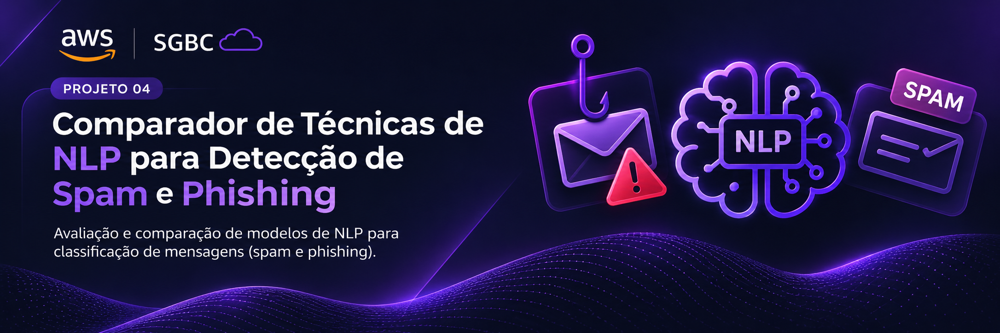

# Comparador de NLP para mensagens

[Comece aqui](docs/COMECE-AQUI.md) · [Aulas](docs/aulas.md) · [Quadro de tarefas](https://github.com/users/andredeomondes/projects/1) · [Contribuir](CONTRIBUTING.md)

Projeto 04 da AWS SBG SENAI CIMATEC. O objetivo é comparar classificadores de texto para mensagens, registrar os resultados e disponibilizar uma interface de teste em Streamlit.

**Entrega prevista:** 7 de dezembro de 2026. **Estado atual:** estrutura de trabalho preparada; implementação conduzida nas aulas e nas issues.

## Como o comparador vai funcionar

Uma mensagem passa pelo pipeline de texto do modelo escolhido. A interface apresenta a classificação e permite consultar os resultados dos modelos avaliados com a mesma divisão de dados.

| Etapa | Tecnologias | Resultado esperado |
| --- | --- | --- |
| Preparar os dados | Python e pandas | Base auditada e divisão reproduzível |
| Treinar e comparar | scikit-learn e TF-IDF | Baseline, Naive Bayes e regressão logística |
| Salvar os experimentos | Joblib | Pipelines completos e metadados |
| Explorar os resultados | Streamlit | Análise de mensagens e comparação dos modelos |

## Começar

1. Leia [Comece aqui](docs/COMECE-AQUI.md) e confira sua tarefa nas [issues](https://github.com/AWS-SBG-Senai-Cimatec/Comparador-t-cnicas-de-Machine-Learning-de-NLP-para-detec-o-e-classifica-o-de-Spam./issues).
2. Prepare o [ambiente](docs/ambiente.md).
3. Siga o [guia de contribuição](CONTRIBUTING.md): branch, commit, PR e revisão.

## O que será entregue

- Dataset documentado e divisões reproduzíveis de treino, validação e teste.
- Baseline e dois classificadores: TF-IDF + Naive Bayes e TF-IDF + regressão logística.
- Comparação com métricas por classe, macro-F1, matriz de confusão e tempo de treino.
- Pipelines salvos com Joblib e metadados de cada execução.
- Interface para escolher o modelo, analisar uma mensagem e consultar os resultados.
- Instruções de reprodução, análise de limitações e proposta de arquitetura AWS.

O dataset indicado tem rótulos binários agregados. O projeto não presume classes independentes para spam e phishing. Consulte [os dados](docs/dados.md) e o [protocolo de avaliação](docs/experimentos.md).

## Quadro de trabalho

[Projeto 04 - AWS SBG SENAI CIMATEC](https://github.com/users/andredeomondes/projects/1)

O quadro acompanha as issues deste repositório. Cada tarefa avança por **Backlog → Pronto → Em andamento → Em revisão → Concluído**, com entrega por PR e revisão de outra pessoa. Veja a [rotina da equipe](docs/rotina-equipe.md).

## Aulas e entregas

Cada aula tem **A: exercício individual de compreensão** e **B: contribuição integrada ao comparador**. A fica em `exercicios/seu-nome/`; B é entregue por PR nas pastas do projeto.

- [Trilha de dez aulas](docs/aulas.md)
- [Construção incremental e critérios de pronto](docs/construcao-incremental.md)
- [Tarefas publicadas](docs/tarefas.md)
- [Equipe e revisão](docs/equipe.md)
- [Rotina de trabalho](docs/rotina-equipe.md)

## Estrutura

```text
.github/       modelos de issue e PR
configs/       configurações dos experimentos, quando implementados
src/           código integrado
docs/          instruções, aulas e decisões técnicas
exercicios/    prática individual
data/exemplos/ dados fictícios para aprender
data/raw/      base real local, fora do Git
data/processed/ dados derivados locais, fora do Git
models/        modelos gerados locais, fora do Git
reports/       métricas e relatórios sem corpos de e-mails
```

Os comandos de treino e do aplicativo serão documentados quando essas etapas forem implementadas. O CSV fictício não deve ser usado para apresentar o desempenho do projeto.

## Licença

A licença do código está em [LICENSE](LICENSE). O dataset tem sua própria licença e atribuição, documentadas em [docs/dados.md](docs/dados.md).
